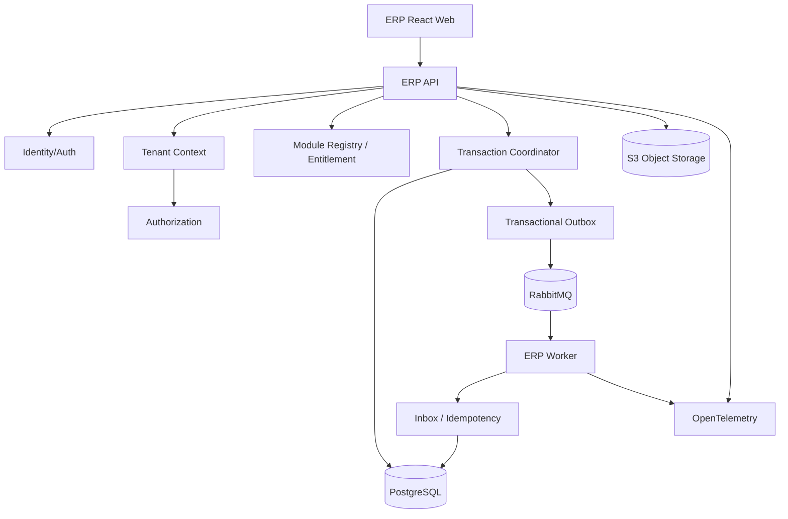
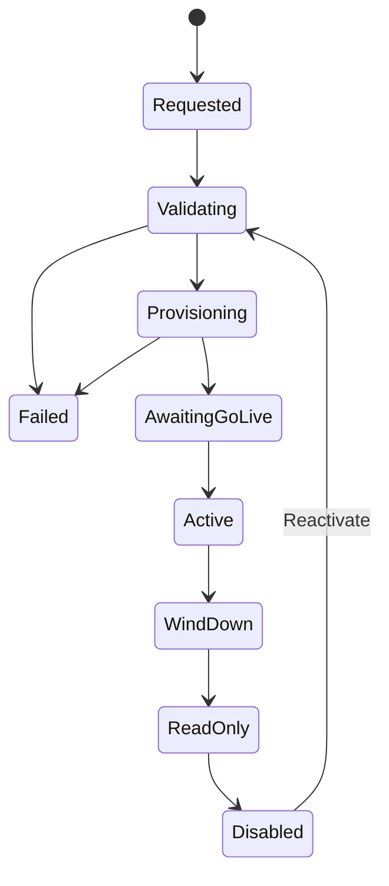
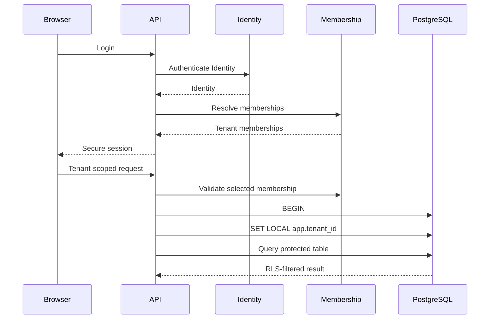
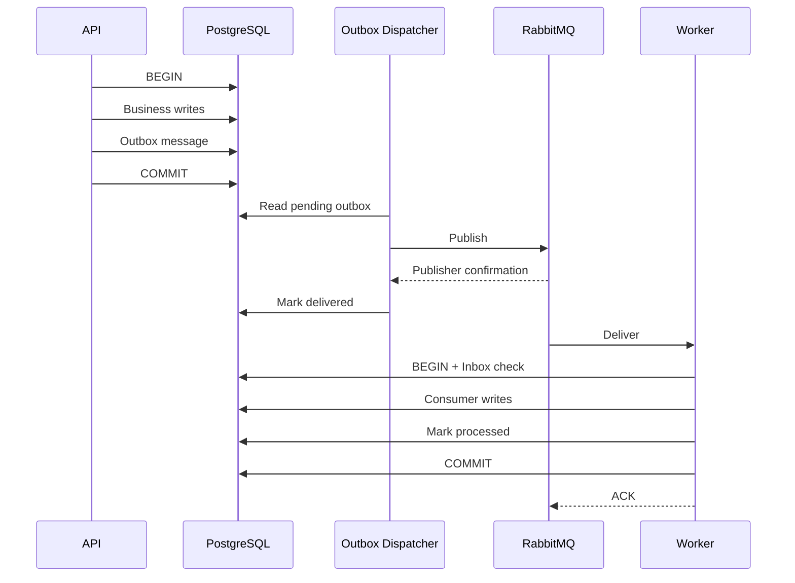

# ERP SaaS — Platform Kernel & Module System Technical Design Pack

**Status:** EXECUTION BASELINE — Agent-Ready  
**Version:** v1.0  
**Date:** 2026-10-05  
**Applies to:** ERP SaaS Master Architecture v3 + Production-Ready Technology Baseline  
**Primary audience:** Implementation Agent, Backend Engineers, Platform Engineers, Reviewers  
**Goal:** Build the platform foundation in the correct order so every future ERP module can be added, activated, deactivated, secured, observed, migrated, and integrated without redesigning the core.

---

# 0. Authority of This Document

This document is the **implementation specification for the Platform Kernel and Module System**.

It does **not** define Sales, Inventory, Accounting, Payroll, or any other business module requirements.

It defines the foundation those modules must use.

When implementing the platform, the agent MUST follow the following precedence:

1. **This Technical Design Pack** — implementation detail for Platform Kernel.
2. **ERP SaaS Master Module & Dependency Blueprint v3** — domain ownership and dependency truth.
3. **Production-Ready Technology Stack & Repository Architecture** — approved technologies and engineering standards.
4. Module Requirements Pack — when a business module is later implemented.
5. An ADR approved after these documents — only when a deliberate architecture change is required.

If implementation discovers a conflict:

> STOP the affected decision, write an ADR candidate, explain the conflict, and do not silently invent a different architecture.

---

# 1. Core Mission

The Platform Kernel must make this statement true:

> A company can use only the ERP modules it is entitled to use, while all tenant data remains isolated, permissions remain correct, module dependencies remain valid, messages remain reliable, audit remains complete, and activating/deactivating modules never corrupts historical data.

The Kernel is **not** a giant business module.

It provides technical and organizational capabilities that every business module can safely rely on.

---

# 2. Locked Architecture

The system is:

```text
Multi-tenant
Modular Monolith
One Codebase
PostgreSQL System of Record
RabbitMQ Message Broker from Day 1
MassTransit transport abstraction
Transactional Outbox
Idempotent Consumers / Inbox
REST + OpenAPI
React Web Client
Module-owned schemas and DbContexts
Synchronous in-process contracts for immediate invariants
Asynchronous integration events after commit
```

The system is **not**:

- Microservices on Day 1.
- Event-sourced as the primary persistence model.
- A plugin marketplace.
- A shared 600-table `ErpDbContext`.
- A collection of modules directly querying one another.
- A system where frontend visibility is treated as security.
- A system where RabbitMQ replaces ACID transactions.

---

# 3. Approved Stack

## Backend

```text
C#
.NET 10 LTS
ASP.NET Core 10
EF Core 10
Npgsql
Dapper only for measured hot/query paths
FluentValidation
NodaTime
MassTransit
RabbitMQ 4.x
Quartz.NET + PostgreSQL persistent store
OpenIddict
ASP.NET Core Identity
OpenTelemetry
Serilog
xUnit
Testcontainers
WireMock.Net
```

## Data & Infrastructure

```text
PostgreSQL 18
RabbitMQ 4.x
S3-compatible Object Storage
Docker
OpenTofu
Managed cloud services where practical
```

## Frontend

```text
React 19.3
TypeScript
Vite 8.1
React Router
TanStack Query
React Hook Form
Zod
MUI / MUI X through ERP design-system wrappers
i18next
Vitest
React Testing Library
Playwright
```

---

# 4. Agent Execution Contract

The implementation agent MUST obey these rules.

## 4.1 Do not skip phases

Each phase has an Exit Gate.

A later phase cannot be considered complete until all previous mandatory gates pass.

## 4.2 Do not implement future business modules

Use a small `SampleModule` only to prove platform contracts.

Do not start:

- Directory.
- Catalog.
- Sales.
- Inventory.
- Ledger.

until the Kernel Definition of Done passes.

## 4.3 Do not add infrastructure because it is fashionable

Do not add without an approved ADR:

- Kubernetes.
- Kafka.
- Redis.
- OpenSearch.
- ClickHouse.
- service mesh.
- separate microservices.

## 4.4 Do not change the approved stack silently

If a package cannot meet a requirement, document the exact limitation before proposing a replacement.

## 4.5 Every platform decision requires tests

No feature is complete because the code compiles.

Tenant isolation, permissions, messaging, module lifecycle, and transaction behavior require integration tests.

---

# 5. Execution Phases — Master Order

The Platform Kernel is implemented in this exact high-level order:

```text
P00  Repository & Toolchain Bootstrap
P01  Solution Boundaries & Architecture Tests
P02  Shared Primitives, IDs, Time, Errors
P03  Observability, Correlation & Request Pipeline
P04  PostgreSQL Runtime Roles, Schemas & DB Session
P05  Multi-Tenancy + PostgreSQL RLS
P06  Organization: Legal Entity + Branch
P07  Identity, Membership & Authentication
P08  Authorization: Roles, Permissions & Scopes
P09  Module Manifest + Registry + Dependency Graph
P10  Entitlements + Capability Resolution
P11  Module Activation / Deactivation / Go-Live Framework
P12  Transaction Coordinator
P13  RabbitMQ + MassTransit Foundation
P14  Transactional Outbox + Consumer Inbox/Idempotency
P15  Audit & Security Event Framework
P16  Numbering / Sequence Engine
P17  Settings & Configuration Framework
P18  Files / Attachments Foundation
P19  Custom Fields Metadata Foundation
P20  Import Framework Foundation
P21  Notifications Foundation
P22  Background Scheduling
P23  OpenAPI / API Client / Frontend Platform Shell
P24  Platform Admin / Support Surfaces
P25  CI/CD, Migration Pipeline & IaC
P26  Security Hardening
P27  Failure / Recovery / Replay Runbooks
P28  Load, Chaos & Isolation Verification
P29  Kernel Release Gate
```

---

# 6. Repository Target

```text
erp-saas/
│
├── src/
│   ├── backend/
│   │   ├── hosts/
│   │   │   ├── Todir.Api/
│   │   │   ├── Todir.Worker/
│   │   │   └── Todir.DbMigrator/
│   │   │
│   │   ├── shared/
│   │   │   ├── Todir.SharedKernel/
│   │   │   ├── Todir.Contracts/
│   │   │   ├── Todir.BuildingBlocks/
│   │   │   └── Todir.Testing/
│   │   │
│   │   ├── platform/
│   │   │   ├── Tenancy/
│   │   │   ├── Organization/
│   │   │   ├── Identity/
│   │   │   ├── Authorization/
│   │   │   ├── Modules/
│   │   │   ├── Entitlements/
│   │   │   ├── Messaging/
│   │   │   ├── Audit/
│   │   │   ├── Numbering/
│   │   │   ├── Settings/
│   │   │   ├── Files/
│   │   │   ├── CustomFields/
│   │   │   ├── Importing/
│   │   │   ├── Notifications/
│   │   │   ├── Scheduling/
│   │   │   └── Observability/
│   │   │
│   │   ├── foundation/
│   │   │   └── .gitkeep
│   │   │
│   │   └── modules/
│   │       └── Sample/
│   │
│   └── frontend/
│       ├── apps/
│       │   └── erp-web/
│       └── packages/
│           ├── api-client/
│           ├── auth/
│           ├── i18n/
│           └── ui/
│
├── tests/
│   ├── architecture/
│   ├── platform/
│   ├── integration/
│   ├── messaging/
│   ├── security/
│   ├── e2e/
│   └── performance/
│
├── docs/
│   ├── architecture/
│   ├── adr/
│   ├── platform/
│   ├── runbooks/
│   └── security/
│
├── ops/
│   ├── compose/
│   ├── containers/
│   ├── terraform/
│   ├── database/
│   ├── rabbitmq/
│   └── monitoring/
│
├── tools/
│   ├── Todir.DevCli/
│   └── module-generator/
│
├── scripts/
├── .github/workflows/
├── Directory.Build.props
├── Directory.Packages.props
├── global.json
├── .editorconfig
├── pnpm-workspace.yaml
├── pnpm-lock.yaml
├── docker-compose.yml
├── README.md
└── Todir.sln
```

---

# 7. P00 — Repository & Toolchain Bootstrap

## Objective

Create a deterministic development environment before application code.

## Tasks

1. Create Git repository.
2. Pin .NET SDK using `global.json`.
3. Configure central NuGet versions.
4. Enable nullable reference types.
5. Treat compiler warnings as errors.
6. Configure analyzers.
7. Pin Node/pnpm.
8. Configure TypeScript strict mode.
9. Add `.editorconfig`.
10. Add secret-scanning rules.
11. Add `.env.example`, never real secrets.
12. Add Docker Compose skeleton.
13. Add basic CI workflow.
14. Add README with one-command developer startup goal.

## Required `Directory.Build.props`

Conceptually:

```xml
<Project>
  <PropertyGroup>
    <TargetFramework>net10.0</TargetFramework>
    <Nullable>enable</Nullable>
    <ImplicitUsings>enable</ImplicitUsings>
    <TreatWarningsAsErrors>true</TreatWarningsAsErrors>
    <Deterministic>true</Deterministic>
  </PropertyGroup>
</Project>
```

Do not copy this blindly if SDK analyzers require a justified exception.

## Exit Gate P00

```text
dotnet restore
dotnet build
pnpm install --frozen-lockfile
pnpm typecheck
```

must succeed in a clean CI runner.

---

# 8. P01 — Solution Boundaries & Architecture Tests

## Objective

Make illegal dependencies fail in CI before business code exists.

## Required project dependency direction

```text
SharedKernel
    ↑
Contracts
    ↑
Platform / Module Implementation
    ↑
Hosts
```

More precisely:

- `Domain` code cannot reference Infrastructure.
- Module implementation may reference another module only through `*.Contracts`.
- Platform Kernel cannot reference business module implementation.
- `SharedKernel` cannot reference a business concept.

## Architecture Tests

Create tests for:

1. No implementation-to-implementation cross-module reference.
2. No cycles in module project graph.
3. No `Infrastructure` namespace referenced by Domain code.
4. Contracts do not depend on Infrastructure.
5. SharedKernel does not reference module assemblies.
6. Platform Kernel does not depend on Foundation/Business implementations.
7. Frontend modules cannot import another module's internals.

## Exit Gate P01

Add an intentionally illegal reference in a test fixture and confirm CI rejects it.

---

# 9. P02 — Shared Primitives, IDs, Time & Errors

## Objective

Lock primitives that would otherwise diverge across modules.

## Required types

```text
TenantId
LegalEntityId
BranchId
IdentityId
MembershipId
UserId
ModuleId
CorrelationId
CausationId
MessageId
EntityRef
ActorRef
```

Use UUIDv7 for distributed identifiers.

## Rules

- Database ID != document number.
- IDs do not expose row sequence.
- IDs are immutable.
- Strongly typed IDs are recommended for critical platform identifiers.

## Time

Use NodaTime.

```text
Instant   → real moment in time
LocalDate → business date
DateTimeZone → entity timezone
```

Never use server local time as business truth.

## Error primitives

Define:

```text
DomainError
ValidationError
ConflictError
ForbiddenError
NotFoundError
ConcurrencyError
```

with stable machine code:

```text
tenant.not_found
module.not_entitled
permission.denied
concurrency.conflict
```

## Exit Gate P02

Unit tests prove:

- UUIDv7 generation.
- serialization.
- UTC/LocalDate conversions.
- ProblemDetails mapping.

---

# 10. P03 — Observability, Correlation & Request Pipeline

## Objective

Every operation must be traceable before real modules exist.

## HTTP pipeline order

Conceptually:

```text
ForwardedHeaders
RequestId / Correlation
Exception Handling
Security Headers
Authentication
Tenant Resolution
Authorization Context
Rate Limiting
Endpoint
```

Exact middleware ordering must be tested.

## Correlation

If inbound header is trusted:

```text
X-Correlation-Id
```

validate format/length.

Otherwise generate a new one.

Use W3C Trace Context for distributed tracing.

## Required structured log properties

```text
service
environment
trace_id
span_id
correlation_id
tenant_id?
legal_entity_id?
membership_id?
actor_id?
actor_type
module
operation
```

## Metric cardinality rule

Do **not** label Prometheus metrics with `tenant_id` by default.

10,000 tenants would create dangerous cardinality.

Tenant IDs may appear in:

- traces;
- logs;
- audit records;

but high-cardinality metrics require a specific reason.

## Exit Gate P03

A sample request must produce one trace covering:

```text
Browser/API request
→ ASP.NET handler
→ PostgreSQL query
```

and later phases extend it through RabbitMQ.

---

# 11. P04 — PostgreSQL Runtime Roles, Schemas & DB Session

## Objective

Separate schema ownership/migrations from application runtime.

## Required PostgreSQL roles

### `erp_owner`

Used only by migrations/deployment.

- owns schemas/tables;
- may create/alter/drop;
- not used by API/Worker runtime.

### `erp_app`

Used by API and Worker.

- no superuser;
- no `BYPASSRLS`;
- does not own tenant tables;
- receives only required DML grants.

### optional `erp_readonly`

For approved reporting/support use later.

## Why

PostgreSQL table owners normally bypass RLS.

Therefore runtime application credentials must not own tenant tables.

## Schema prefixes

```text
platform_tenancy
platform_org
platform_iam
platform_authz
platform_modules
platform_entitlements
platform_messaging
platform_audit
platform_numbering
platform_settings
platform_files
platform_custom_fields
platform_import
platform_notifications
platform_scheduling
```

## Exit Gate P04

Integration test connects as `erp_app` and verifies it cannot:

- alter a table;
- disable RLS;
- read forbidden tenant rows after RLS phase.

---

# 12. P05 — Multi-Tenancy + PostgreSQL RLS

## Objective

Tenant isolation is a database-enforced security boundary.

## Tenant hierarchy

```text
Tenant
  └── Legal Entity
        └── Branch
```

Tenant is the security boundary.

Legal Entity and Branch are authorization/business scopes.

## Tenant table

Schema: `platform_tenancy`

Conceptual table:

```sql
tenant (
    id uuid primary key,
    slug text not null unique,
    display_name text not null,
    status text not null,
    default_locale text,
    default_timezone text,
    created_at timestamptz not null,
    version bigint not null
)
```

## Tenant status

```text
Provisioning
Active
Suspended
Closing
Closed
```

Suspended does not mean delete.

## TenantContext

Required interface:

```csharp
public interface ITenantContext
{
    bool IsResolved { get; }
    TenantId TenantId { get; }
}
```

Tenant ID MUST NOT be accepted from normal business request bodies.

Tenant is resolved from authenticated membership/context.

## Database RLS contract

Every tenant-owned table contains:

```text
tenant_id uuid NOT NULL
```

and:

```sql
ALTER TABLE ... ENABLE ROW LEVEL SECURITY;
ALTER TABLE ... FORCE ROW LEVEL SECURITY;
```

Policy concept:

```sql
USING (
  tenant_id = current_setting('app.tenant_id', true)::uuid
)
WITH CHECK (
  tenant_id = current_setting('app.tenant_id', true)::uuid
)
```

## Critical runtime rule

Use:

```sql
SET LOCAL app.tenant_id = '...';
```

inside an explicit PostgreSQL transaction.

This prevents pooled connection state from becoming a tenant-leak risk.

## Query transactions

Even read paths that access tenant data must execute inside a tenant DB scope so `SET LOCAL` is valid.

Do not stream long HTTP responses while holding a DB transaction.

## Background workers

A worker must:

1. receive trusted `tenant_id` from the message envelope;
2. validate tenant exists/status;
3. establish `TenantContext`;
4. begin DB transaction;
5. apply `SET LOCAL`;
6. only then query tenant tables.

## Composite key defense

Where appropriate use:

```text
(tenant_id, id)
```

for tenant-scoped FK integrity.

## Mandatory security tests

1. Tenant A cannot SELECT Tenant B rows.
2. Tenant A cannot UPDATE Tenant B rows.
3. Tenant A cannot INSERT row claiming Tenant B.
4. Tenant context missing => default deny.
5. Raw SQL executed by runtime role is still protected.
6. Worker cannot process tenant data before context is established.
7. Table owner behavior does not apply to runtime role.
8. Every new tenant table is detected if RLS is missing.

## CI RLS Linter

Write a database integration assertion:

> every table registered as tenant-owned must have RLS enabled and forced.

## Exit Gate P05

A red-team integration suite must fail cross-tenant access using the actual `erp_app` runtime role.

No mocked tenant tests qualify.

---

# 13. P06 — Organization: Legal Entity & Branch

## Objective

Create organizational scope required by all later modules.

## `legal_entity`

Owned by `platform_org`.

Minimum fields:

```text
id
tenant_id
code
legal_name
trade_name?
country_code
base_currency_code
timezone
locale
status
created_at
version
```

Do not put country-specific tax fields in Global Core.

Those come from Country Packs/extensions.

## `branch`

Minimum:

```text
id
tenant_id
legal_entity_id
code
name
timezone_override?
status
created_at
version
```

## Rules

- Legal Entity belongs to one Tenant.
- Branch belongs to one Legal Entity.
- Historical business data never changes owner because branch metadata changed.
- Archive instead of delete when referenced.
- Country is on Legal Entity, not Tenant.

## Exit Gate P06

Authorization scope tests can distinguish:

```text
Tenant-wide
LegalEntity-specific
Branch-specific
```

---

# 14. P07 — Identity, Membership & Authentication

## Objective

Separate login identity from tenant membership and future employee records.

## Critical distinction

```text
Identity != Membership != Employee
```

Employee does not exist yet in Kernel.

## Identity

Global authentication identity.

Conceptual fields:

```text
id
normalized_email
email_verified
phone?
password/security metadata via ASP.NET Identity
status
created_at
last_login_at?
```

An identity may belong to multiple tenants.

## Membership

Tenant-scoped relationship:

```text
id
tenant_id
identity_id
display_name
status
default_legal_entity_id?
default_branch_id?
locale?
timezone?
created_at
```

## Membership state

```text
Invited
Active
Suspended
Revoked
```

## Login flow

```text
Identity authentication
        ↓
List active memberships
        ↓
Choose / resolve tenant
        ↓
Create tenant-scoped session context
        ↓
Membership authorization
```

## Web authentication

For ERP web:

- secure HttpOnly cookie;
- Secure flag;
- SameSite policy;
- CSRF protection;
- no auth tokens in `localStorage`.

## OpenIddict

Configure as OAuth2/OIDC foundation for:

- public API clients;
- integrations;
- future mobile/partner applications.

Authorization Code + PKCE is the approved user-facing OAuth flow.

## MFA

Support from the start:

- TOTP;
- recovery codes.

Step-up hooks for sensitive operations are designed now.

## Exit Gate P07

E2E tests:

1. Register/bootstrap platform admin.
2. Create Tenant.
3. Invite user.
4. User accepts membership.
5. User can switch between two tenant memberships.
6. Tenant A session cannot call Tenant B.
7. Suspended membership immediately loses access.

---

# 15. P08 — Authorization: Roles, Permissions & Scopes

## Objective

Create reusable authorization without a future God-role system.

## Permission ownership

Each module declares its permission catalog in its Manifest.

Examples:

```text
sales.order.read
sales.order.create
sales.order.confirm
sales.price.override
inventory.cost.view
ledger.period.close
```

Kernel does not manually own one huge hard-coded permission list.

## Role model

`platform_authz.role`

```text
id
tenant_id
code
name
is_system_template
is_active
version
```

`role_permission`

```text
tenant_id
role_id
permission_code
```

## Assignment model

`membership_role_assignment`

```text
tenant_id
membership_id
role_id
scope_type
scope_id?
```

Allowed scope types initially:

```text
Tenant
LegalEntity
Branch
```

## Permission evaluation

Concept:

```csharp
Authorize(
    membership,
    permission: "sales.order.confirm",
    resourceScope: LegalEntity/Branch
)
```

## Field restrictions

Do not create generic column-level ABAC complexity.

Use explicit permission codes:

```text
inventory.cost.view
sales.margin.view
payroll.compensation.view
```

## Separation of duties hook

Kernel must support policy checks such as:

```text
Creator cannot approve
Creator cannot pay
Salary editor cannot finalize payroll
```

Actual policies belong to the relevant modules/Approvals later.

## UI rule

Frontend permission checks only hide/disable UI.

Backend command handlers MUST authorize independently.

## Cache

Permission resolution may use short-lived in-memory cache.

Invalidation required when:

- role permissions change;
- assignment changes;
- membership status changes;
- module activation changes.

Do not introduce Redis just for this on Day 1.

## Exit Gate P08

Tests prove:

- Tenant role does not leak across tenant.
- Entity scope works.
- Branch scope works.
- UI-hidden endpoint is still forbidden via direct HTTP call.
- permission change invalidates effective access.

---

# 16. P09 — Module Manifest + Registry + Dependency Graph

## Objective

Create the formal module system all future modules use.

## Manifest format

Use a file:

```text
module.manifest.json
```

inside each significant module.

Reason:

- CI can read it without loading application assemblies.
- tooling can validate dependency graph;
- module generator can create it;
- documentation can be generated from it.

Runtime registration still uses strongly typed C# module registration.

## Manifest minimum schema

```json
{
  "id": "sample",
  "version": "1.0.0",
  "contractsVersion": 1,
  "layer": "L2",
  "type": "business",
  "purchasable": true,
  "scope": "legal_entity",

  "dependencies": {
    "hard": [],
    "optionalCapabilities": []
  },

  "owns": {
    "schema": "sample",
    "entities": []
  },

  "permissions": [],

  "capabilities": {
    "provides": [],
    "consumes": []
  },

  "messaging": {
    "publishes": [],
    "consumes": []
  },

  "lifecycle": {
    "supportsGoLive": true,
    "deactivationPolicy": "wind_down"
  }
}
```

## Module ID rules

- Lowercase stable identifier.
- Never renamed after public release.
- Display label may change.
- ID is not localization text.

## Module Registry

Runtime registry exposes:

```csharp
IModuleRegistry.Get(moduleId)
IModuleRegistry.GetAll()
IModuleRegistry.GetHardDependencies(moduleId)
IModuleRegistry.GetDependents(moduleId)
```

## Hard dependency graph

Must be a DAG.

CI must reject:

```text
A -> B -> C -> A
```

## Optional capabilities

Do not model every optional relationship as module-to-module dependency.

Prefer a capability:

```text
IFulfillment
ICreditCheck
IApprovalGuard
IComplianceSubmission
```

## Registry startup validation

Application startup fails if:

- duplicate Module ID;
- missing manifest;
- invalid version;
- hard dependency missing from codebase;
- hard cycle;
- duplicate owned schema;
- duplicate permission owner where forbidden;
- malformed event contract declaration.

## Exit Gate P09

Create `SampleModuleA` and `SampleModuleB`.

Tests prove:

- hard dependency ordering;
- missing dependency failure;
- cycle failure;
- registry retrieval;
- manifest JSON Schema validation.

---

# 17. P10 — Entitlements + Capability Resolution

## Objective

Separate commercial permission to use a module from operational module code.

## Architectural split

### Control Plane

Owns eventually:

```text
ModuleCatalog
Plan
Subscription
AddOn
EntitlementGrant
Usage Limits
Billing
```

Control Plane is separate from tenant business data.

### Tenant Plane

Owns/enforces:

- validated Entitlement Snapshot;
- operational Module State;
- effective Capability Set.

The Kernel pack implements Tenant Plane enforcement now.

Full commercial billing Control Plane is a later platform workstream, but its contract is locked now.

## Entitlement Snapshot

Concept:

```text
tenant_id
snapshot_version
issued_at
valid_until
signature/key_id
modules[]
features[]
limits[]
scopes[]
```

Production snapshots must be authenticity-verified.

## Enforcement

Three layers:

1. endpoint/route guard;
2. application command guard;
3. UI navigation.

UI is never the security layer.

## Important distinction

```text
Entitled != Active
```

A tenant may be entitled to Inventory but has not completed Inventory Go-Live.

## Capability Resolver

Interface concept:

```csharp
public interface ICapabilityResolver
{
    T Resolve<T>(CapabilityContext context) where T : class;
    bool IsAvailable<T>(CapabilityContext context);
}
```

## Fallback contract

Every optional capability must explicitly define absence behavior.

Examples:

```text
Inventory missing → Manual Fulfillment provider
Approvals missing → Fixed policy / AlwaysAllow where safe
Credit module missing → Subledger basic credit provider
```

Never use `null` scattered throughout module code as optional integration logic.

## Exit Gate P10

Sample module endpoint:

- returns 403 if not entitled;
- works after entitlement snapshot update;
- capability cache invalidates immediately;
- optional provider resolves fallback correctly.

---

# 18. P11 — Module Lifecycle + Go-Live Framework

## Objective

Activation/deactivation must be explicit workflows, not database toggles.

## Module state table

`platform_modules.module_instance`

Concept:

```text
id
tenant_id
module_id
scope_type
scope_id
status
mode?
manifest_version
go_live_at?
activated_at?
read_only_at?
disabled_at?
version
```

## States

```text
Requested
Validating
Provisioning
AwaitingGoLive
Active
WindDown
ReadOnly
Disabled
Failed
```

## Activation operation

`module_operation`

```text
id
tenant_id
module_instance_id
operation_type
status
requested_by
started_at
completed_at
error_code?
error_details_ref?
idempotency_key
```

## Activation algorithm

1. acquire tenant/module advisory lock;
2. verify entitlement;
3. calculate hard-dependency closure;
4. verify dependency states;
5. verify scope prerequisites;
6. verify Country Pack prerequisites if declared;
7. run idempotent provisioning contributors;
8. generate activation report;
9. if stateful module: wait for Go-Live inputs;
10. commit Go-Live;
11. mark Active;
12. publish `ModuleActivated.v1`.

## Lifecycle contributor

Concept:

```csharp
public interface IModuleLifecycleContributor
{
    Task ValidateActivation(...);
    Task Provision(...);
    Task PrepareGoLive(...);
    Task ValidateDeactivation(...);
    Task WindDown(...);
}
```

## Provisioning rules

Provisioning tasks must be:

- idempotent;
- individually logged;
- resumable;
- safe after worker restart.

Never drop user data in rollback.

## Module Go-Live Contract

Every stateful module declares:

```text
go_live_date
opening_data_required
open_document_transition_policy
historical_boundary
backfill_policy
reconciliation_checks
```

## Example: module added later

A company used Sales for one year and activates Inventory today.

Inventory Go-Live:

```text
Opening stock imported at Go-Live.
Historical Sales does not fabricate old stock moves.
Open Sales orders are explicitly transitioned.
Post-Go-Live deliveries use Inventory.
```

## Deactivation algorithm

1. entitlement/subscription change triggers impact report;
2. hard dependents => block;
3. open documents => wind-down requirements;
4. optional consumers => fallback preview;
5. financial/legal retention => enforce read-only/history;
6. disable new operations;
7. preserve data;
8. publish `ModuleDeactivated.v1`.

## Rule

> Deactivate never means schema/table deletion.

## Exit Gate P11

Scenario tests:

1. Activate SampleModule.
2. Retry same activation idempotently.
3. Crash during provisioning and resume.
4. Hard dependency missing => block.
5. Deactivate with dependent => block.
6. Deactivate with optional consumer => fallback.
7. Reactivate preserves configuration/data.

---

# 19. P12 — In-Process Transaction Coordinator

## Objective

Guarantee atomicity across module schemas inside the Modular Monolith.

## Why required

A future operation such as:

```text
Post Invoice
  + create Subledger Open Item
  + post Ledger Fact
  + write Audit
  + persist Outbox message
```

must commit or rollback together.

RabbitMQ cannot replace this transaction.

## Approved model

One physical PostgreSQL database.

A coordinated operation shares:

```text
one NpgsqlConnection
one NpgsqlTransaction
one TenantContext
one RLS transaction context
multiple module DbContexts enlisted into that transaction
```

## Interface concept

```csharp
public interface ITransactionCoordinator
{
    Task<T> ExecuteAsync<T>(
        Func<ITransactionContext, CancellationToken, Task<T>> action,
        CancellationToken cancellationToken = default);
}
```

`ITransactionContext` exposes safe module DbContext enlistment through factories.

## Internal sequence

```text
Open connection
↓
Begin transaction
↓
SET LOCAL app.tenant_id
↓
Create/enlist DbContexts
↓
Execute use case
↓
SaveChanges on participants
↓
Flush integration event buffer to Outbox
↓
Commit
```

On any failure:

```text
ROLLBACK
```

## Rules

- No distributed transaction.
- No RabbitMQ publish before DB commit.
- No nested independent transaction inside coordinated invariant.
- Avoid cross-module transaction unless a documented invariant requires it.

## Transaction participation

Each participating module must declare whether its command supports an external coordinated transaction.

## Concurrency

Use PostgreSQL row locking/advisory locks only where a domain invariant requires it.

Do not globally serialize a tenant.

## Exit Gate P12

Integration test with SampleModuleA + SampleModuleB:

- both save on success;
- both rollback if second fails;
- outbox row rolls back too;
- RLS tenant context is active in both contexts.

---

# 20. P13 — RabbitMQ + MassTransit Foundation

## Objective

Provide stable, secure asynchronous integration from Day 1.

## Topology rule

Do **not** create queue/exchange per tenant.

10,000 tenants must not create 10,000 copies of every endpoint.

Topology is by consumer responsibility.

Example:

```text
compliance.invoice-posted
notifications.invoice-posted
reporting.invoice-posted
integrations.invoice-posted
```

Tenant ID travels in trusted envelope/headers.

## Environment isolation

Use separate RabbitMQ vhosts:

```text
/erp-dev
/erp-staging
/erp-prod
```

## Queue type

For long-lived critical production queues:

> Use Quorum Queues.

RabbitMQ documents quorum queues as the modern replicated, highly available choice for critical durable queues.

Local development may use simpler topology when necessary, but staging must match production semantics.

## Endpoint names

Use stable kebab-case names.

Example:

```text
erp-compliance-invoice-posted
erp-notifications-invoice-posted
```

Do not include deployment instance ID.

## Message naming

Event:

```text
InvoicePostedV1
OrderConfirmedV1
PaymentReceivedV1
```

Event names indicate something already happened.

Command:

```text
SubmitInvoiceForComplianceV1
SendNotificationV1
```

## Public message location

```text
Todir.Modules.X.Contracts
```

Never publish:

- EF entity;
- aggregate object;
- internal request DTO;
- anonymous object.

## Exit Gate P13

Sample event:

```text
SampleEntityCreatedV1
```

must flow:

```text
API
→ outbox later
→ RabbitMQ
→ Worker consumer
```

with trace continuity.

---

# 21. Message Envelope Standard

Every integration message receives standard metadata.

Required:

```text
MessageId
MessageType
SchemaVersion
OccurredAtUtc

TenantId
LegalEntityId?
BranchId?

CorrelationId
CausationId

ActorId?
ActorType
SourceModule
SourceRef?
TraceParent?
```

## Actor types

```text
Human
System
Automation
AI
Service
Support
```

## Payload rule

Payload must contain only what the consumer needs.

Do not include:

- passwords;
- access tokens;
- certificates;
- full sensitive employee records.

## Snapshot vs lookup

Include immutable business snapshot if consumer must know historical values.

Otherwise prefer IDs.

Example:

A legal invoice event may include immutable invoice document snapshot ID/reference rather than ask consumer to read mutable Sales data.

---

# 22. P14 — Transactional Outbox + Inbox / Idempotency

## Objective

Prevent DB/message split-brain and duplicate side effects.

## Delivery semantics

Assume:

> At-least-once.

RabbitMQ acknowledgements and publisher confirmations improve reliable delivery but duplicates remain possible after failures.

Consumers must be idempotent.

## Outbox rule

Never:

```text
SaveChanges
then directly Publish
```

as separate reliability steps.

## Approved MassTransit integration

Use MassTransit EF transactional outbox where it aligns with the owning module DbContext.

Each state-changing module can include MassTransit outbox entities in its own schema/DbContext.

The Kernel provides configuration conventions so every module uses the same pattern.

## Cross-module atomic operation

For a coordinated transaction:

1. domain operations occur in enlisted DbContexts;
2. integration events are collected in scoped event buffer;
3. the initiating transaction's outbox persists publish intents;
4. DB commits;
5. MassTransit delivery service publishes after commit.

Do not publish an event from a nested module before outer commit.

## Consumer Outbox / Inbox

For a consumer that writes one owning module:

- use MassTransit consumer outbox with that module DbContext where possible.

For a consumer requiring a coordinated multi-module DB transaction:

- use the Platform transaction coordinator;
- enforce message idempotency inside the same DB transaction;
- validate this pattern with a dedicated integration test before real module use.

## Inbox key

At minimum:

```text
consumer_endpoint
message_id
```

A message processed by two different consumer responsibilities is valid.

## Acknowledgement rule

A message is acknowledged only after required durable DB work commits.

## Mandatory tests

1. DB rollback => event not published.
2. Broker unavailable => DB commits + outbox waits.
3. Broker returns => outbox drains.
4. Duplicate delivery => side effect once.
5. Consumer crashes before commit => message returns.
6. Consumer crashes after commit before ack => re-delivery does not duplicate.
7. poison message reaches error path.
8. replay remains idempotent.

## Exit Gate P14

Run failure injection tests, not only happy-path tests.

---

# 23. Retry / Redelivery / Error Policy

## Immediate retry

For short transient errors only:

```text
100ms
300ms
1s
```

Example count may be three attempts.

Do not retry validation/business-rule exceptions.

## Longer redelivery

Use scheduled redelivery strategy backed by approved persistent scheduling.

Do not require an unapproved RabbitMQ plugin merely for delay behavior.

Example schedule:

```text
30 sec
2 min
10 min
30 min
```

Exact policy belongs to each consumer definition.

## Fatal errors

Examples:

- invalid legal input;
- unsupported schema version;
- missing tenant;
- permission/contract bug.

Send to operational error queue with clear reason.

## Error queue operation

Support operator command:

```text
erp message inspect <id>
erp message replay <id>
```

Replay requires permission and audit.

---

# 24. P15 — Audit & Security Event Framework

## Objective

Create legally/operationally useful audit independent of application logs.

## Audit entity

Concept:

```text
id
tenant_id
legal_entity_id?
branch_id?

actor_type
actor_id?
membership_id?

module
action
entity_type
entity_id

before_json?
after_json?
changed_fields?

reason?
source
correlation_id
trace_id
occurred_at

metadata_json?
```

## Audit rules

Audit entries are append-only.

Runtime role should not have normal UPDATE/DELETE permission on audit rows.

## Must audit

- role/permission changes;
- membership changes;
- module activation/deactivation;
- entitlement override;
- support access;
- numbering override;
- sensitive setting changes;
- file access to sensitive categories where required;
- manual message replay;
- security events;
- later: critical domain transitions.

## Sensitive data

Audit serializer must support redaction.

Never save plaintext password/token.

## Application log vs Audit

Do not derive business audit from Serilog.

They solve different problems.

## Exit Gate P15

Attempt to update/delete an audit entry using runtime role must fail.

---

# 25. P16 — Numbering / Sequence Engine

## Objective

Provide one correct document-numbering engine for future modules.

## Entity ID vs document number

Always separate.

```text
invoice_id = UUIDv7
invoice_number = INV-2026-000123
```

## Sequence definition

Concept:

```text
sequence_key
tenant_id
legal_entity_id?
branch_id?
scope_key?
period_key?
prefix_template
suffix_template?
padding
next_value
mode
version
```

## Modes

```text
Standard
GapControlled
RegulatoryStrategy
```

Do not claim every ERP document must be globally gapless.

Gap requirements depend on business/legal rules.

## Allocation timing

For final/legal numbers:

> allocate inside the same transaction that finalizes the document.

Do not consume legal numbers when Draft is created unless a Country Pack specifically requires reservation.

## Locking

Use row-level locking for the sequence row.

Keep the locked transaction short.

## Future readiness

Strategy seam supports later:

- fiscal year;
- branch;
- legal entity;
- POS device ICV;
- country-specific hash/chain requirement.

Do not implement country-specific law in Kernel.

## Exit Gate P16

Concurrency test with many parallel allocations proves uniqueness and deterministic sequence behavior.

---

# 26. P17 — Settings & Configuration Framework

## Objective

Separate environment configuration from tenant business configuration.

## Categories

### Environment configuration

Examples:

```text
DB connection
RabbitMQ host
S3 endpoint
OTLP endpoint
```

Lives in app configuration/secret store.

### Tenant/platform settings

Audited database configuration.

Examples:

```text
default language
theme
timezone defaults
```

### Module settings

Owned/registered by module.

Examples later:

```text
negative_stock_policy
discount_approval_threshold
```

## Settings registry

Modules register definitions:

```text
key
type
scope
default
validation
sensitivity
```

## Initial scopes

```text
Tenant
LegalEntity
Branch
User
```

Resolution:

> Most-specific valid override wins.

Do not create Department/Employee scope in Kernel until a domain requires it.

## Data type

Value can use JSONB but definition enforces actual type.

## Audit

Sensitive changes include:

- before;
- after;
- actor;
- reason if required.

## Exit Gate P17

Test inheritance:

```text
Tenant default
→ Entity override
→ Branch override
→ User override
```

and invalid type rejection.

---

# 27. P18 — Files & Attachments Foundation

## Objective

Store file metadata safely while bytes live in object storage.

## Object storage

S3-compatible abstraction.

Local:

```text
MinIO
```

Production:

managed object storage.

## File metadata

Concept:

```text
file_id
tenant_id
owner_module
owner_entity_type
owner_entity_id

object_key
original_name
content_type
size
sha256
status
classification
created_by
created_at
```

## Object key

```text
tenant/{tenantId}/{module}/{entityType}/{entityId}/{fileId}
```

Never trust filename as storage key.

## Upload lifecycle

```text
Requested
→ Uploading
→ Quarantined
→ Scanned
→ Ready
   or
→ Rejected
```

## Production file security

- signed upload/download URLs;
- tenant authorization before URL issuance;
- size limit;
- MIME validation;
- magic-byte/file signature validation;
- malware scanning for user-provided files;
- never public bucket.

## Deletion

Business entity deletion does not automatically delete legal attachment.

Retention policy decides.

## Exit Gate P18

Cross-tenant signed URL test must fail.

---

# 28. P19 — Custom Fields Metadata Foundation

## Objective

Future customization without schema chaos or a global EAV database.

## Ownership rule

Kernel owns:

```text
CustomFieldDefinition metadata
```

Owning module owns:

```text
custom field values
```

## Definition

Concept:

```text
field_id
tenant_id
target_entity_type
stable_key
label_ar
label_en
field_type
required_ui
default_value?
validation?
visibility?
status
version
```

## Field ID

Immutable.

Labels may change.

Layouts refer to stable field IDs, not DB column names.

## Value storage

Default strategy:

- owner module has `custom_data jsonb` where suitable;
- indexing only for approved searchable custom fields;
- module remains responsible for query performance.

Do not create one giant cross-module EAV table.

## Forbidden custom fields

Custom fields cannot directly:

- change financial posting;
- calculate payroll law;
- bypass permissions;
- change tenant ownership.

## Exit Gate P19

Rename a custom-field label without losing values or layout references.

---

# 29. P20 — Import Framework Foundation

## Objective

Provide reusable migration/import orchestration.

## Import lifecycle

```text
Upload
→ Detect
→ Map
→ Validate
→ Preview
→ DryRun
→ Execute
→ Reconcile
→ Completed
```

or:

```text
FailedCorrectable
FailedFatal
Cancelled
```

## Core tables

`import_batch`

```text
id
tenant_id
module_id
importer_id
status
file_id
mapping_json
progress
created_by
created_at
```

`import_error`

```text
batch_id
row_number
column_key?
code
message_params
severity
```

## Importer contract

```csharp
public interface IImporter
{
    string ImporterId { get; }
    Task<DetectionResult> Detect(...);
    Task<ValidationResult> Validate(...);
    Task<PreviewResult> Preview(...);
    Task ExecuteChunk(...);
    Task<ReconciliationResult> Reconcile(...);
}
```

## Background processing

Large imports use Worker + RabbitMQ.

HTTP returns `202 Accepted`.

## Idempotency

Batch/chunk operations are resumable.

## Rollback

Importer declares:

```text
SafeBeforeUse
Compensating
NoAutomaticRollback
```

Never promise rollback after posted/legally used data.

## Exit Gate P20

Sample importer survives worker restart halfway through and resumes without duplicate records.

---

# 30. P21 — Notifications Foundation

## Objective

Decouple business events from delivery channels.

## Channels

Initially:

```text
InApp
Email
```

Designed:

```text
WhatsApp
SMS
```

## Rule

A Sales module never calls SMTP directly.

It emits an event / notification request.

## Notification entity

Concept:

```text
id
tenant_id
recipient_ref
template_key
channel
payload
status
attempts
created_at
sent_at?
```

## Templates

Versioned.

Language-aware.

Tenant branding allowed through safe variables.

## Exit Gate P21

Sample event triggers one in-app/email notification without the Sample module knowing provider implementation.

---

# 31. P22 — Background Scheduling

## Objective

Persistent time-based execution.

Use Quartz.NET with PostgreSQL persistent store.

## Jobs

Kernel jobs may include:

- stale operation cleanup;
- certificate expiry check later;
- scheduled notification dispatch;
- reconciliation scheduling later.

## Rule

Quartz decides **when**.

RabbitMQ/worker handles **distributed work** where appropriate.

## Exit Gate P22

Scheduled job survives Worker restart and does not execute twice incorrectly under multi-instance deployment.

---

# 32. P23 — API & Frontend Platform Shell

## Objective

Create the reusable frontend/application shell before business screens.

## API conventions

Base:

```text
/api/v1
```

Use RFC Problem Details.

Critical state transitions are explicit action endpoints.

Example:

```text
POST /api/v1/modules/{moduleId}/activate
```

not:

```text
PUT status = active
```

## Required headers/behavior

- correlation ID;
- concurrency/ETag strategy where applicable;
- idempotency key for critical POST;
- pagination for lists.

## OpenAPI

Generate from backend.

Generate TypeScript client.

Generated client is not manually edited.

## Frontend shell

Must implement:

- login;
- tenant switcher;
- legal entity switcher;
- branch context;
- module-aware navigation;
- permission-aware navigation;
- localization;
- RTL;
- global error boundary;
- unauthorized/forbidden screens;
- operation progress shell.

## Exit Gate P23

Changing an API DTO breaks generated-client drift check in CI until regeneration is committed.

---

# 33. P24 — Platform Admin & Support Surfaces

## Objective

Operate the platform without direct production DB manipulation.

## Tenant Admin capabilities

- memberships;
- roles;
- module state;
- settings;
- audit views permitted to tenant;
- usage/entitlement summary.

## Platform Support

Support access is exceptional.

## Break-glass support workflow

```text
Support requests access
→ reason required
→ tenant/admin approval when possible
→ time-limited grant
→ strong MFA
→ visible banner
→ full audit
→ automatic expiry
```

No permanent hidden support superuser browsing all tenants.

## Exit Gate P24

Support access expires automatically and all access appears in audit.

---

# 34. P25 — CI/CD, Database Migration & IaC

## Objective

Make production deploy repeatable.

## Pull Request CI

Mandatory:

```text
restore
format/lint
compile
typecheck
unit tests
architecture tests
integration tests
RLS tests
messaging tests
contract tests
OpenAPI generation
breaking change check
frontend tests
container build
security/dependency scan
migration validation
```

## Production CD

```text
Build immutable images
→ scan
→ deploy staging
→ smoke/E2E
→ approval
→ DB migrator
→ deploy API/Worker/Web
→ post-deploy health
```

## Image tags

Use commit SHA.

Never `latest`.

## Migration host

`Todir.DbMigrator`

API/Worker must not auto-apply production schema migrations.

## Migration order

Discover module manifests and run migrations in hard-dependency topological order.

## EF migration history

Configure module-specific migration history/schema.

## Expand/contract

Required for destructive/rename schema changes.

## IaC

Use OpenTofu.

## Exit Gate P25

Create staging environment from IaC and deploy without manual database edits.

---

# 35. P26 — Security Hardening

## Required controls

- TLS everywhere externally.
- RabbitMQ private network + TLS.
- HSTS.
- secure HttpOnly cookies.
- CSRF protection.
- strict CORS.
- CSP.
- request body limits.
- upload limits.
- brute-force/rate limits.
- MFA.
- secret manager.
- Data Protection keys persisted/encrypted.
- DB least privilege.
- no runtime schema ownership.
- S3 private bucket.
- webhook signature support.
- audit.
- dependency/container scanning.

## Rate limiting

Key by:

- authenticated tenant/membership;
- API client;
- IP for anonymous auth endpoints.

Do not use tenant IDs as unbounded Prometheus metric labels.

## Secrets

Never log:

```text
password
refresh/access token
private key
government certificate secret
payment credential
```

## Exit Gate P26

Threat model reviewed for:

- cross-tenant leakage;
- privilege escalation;
- SSRF via connectors/files;
- object-storage URL leakage;
- message forgery;
- replay;
- broken authorization;
- support abuse.

---

# 36. P27 — Failure, Recovery & Replay Runbooks

## Required runbooks

```text
deploy
rollback application
database migration forward-fix
database restore
RabbitMQ unavailable
outbox backlog
consumer poison message
message replay
worker outage
object storage outage
identity incident
secret rotation
support-access incident
tenant offboarding/export
```

## Broker outage expected behavior

If RabbitMQ is unavailable:

- synchronous DB transaction may commit if async work is not part of the immediate invariant;
- outbox retains messages;
- dispatcher retries;
- alert backlog.

## DB outage

- writes fail safely;
- worker must not acknowledge messages before durable required work;
- API returns service-unavailable behavior.

## Exit Gate P27

Run one controlled outage drill in staging.

---

# 37. P28 — Load, Chaos & Isolation Verification

## Objective

Prove platform assumptions before business complexity.

## Minimum load tests

- authentication.
- tenant context.
- permission evaluation.
- module registry.
- entitlement guard.
- outbox drain.
- consumer throughput.
- file signed URL generation.
- import job scheduling.

## Broker recovery test

1. stop RabbitMQ;
2. create operations producing outbox messages;
3. verify DB succeeds where allowed;
4. restart broker;
5. verify backlog drains;
6. verify no duplicates.

## Worker crash test

Crash after DB commit but before ACK.

Verify re-delivery is idempotent.

## Noisy tenant test

Generate heavy workload for Tenant A.

Confirm Tenant B still receives acceptable API/worker service.

Initial mechanisms:

- API rate limits;
- bounded consumer concurrency;
- query timeouts;
- job fairness design.

Do not create per-tenant queues as the first solution.

## Exit Gate P28

Results recorded in `docs/platform/kernel-verification.md`.

---

# 38. P29 — Kernel Release Gate

The Platform Kernel is ready for the first real Foundation module only if all items below pass.

## Repository

- [ ] deterministic build
- [ ] pinned dependencies
- [ ] architecture tests

## Tenant isolation

- [ ] runtime DB role does not bypass RLS
- [ ] all tenant tables force RLS
- [ ] cross-tenant fuzz tests
- [ ] worker tenant context tests

## Identity

- [ ] membership switch
- [ ] MFA
- [ ] secure cookies
- [ ] session revocation

## Authorization

- [ ] tenant/entity/branch scopes
- [ ] backend permission enforcement
- [ ] permission invalidation

## Modules

- [ ] manifest JSON schema
- [ ] registry
- [ ] dependency DAG
- [ ] entitlement guard
- [ ] activation/deactivation
- [ ] go-live framework
- [ ] capability fallback

## Transactions

- [ ] shared Npgsql transaction
- [ ] multi-DbContext atomic test
- [ ] rollback test
- [ ] concurrency test

## Messaging

- [ ] RabbitMQ TLS in staging
- [ ] stable endpoints
- [ ] quorum queues for critical staging topology
- [ ] outbox
- [ ] inbox/idempotency
- [ ] retry/redelivery
- [ ] error queue
- [ ] replay
- [ ] correlation/trace propagation

## Platform services

- [ ] audit
- [ ] numbering
- [ ] settings
- [ ] files
- [ ] custom-field registry
- [ ] import framework
- [ ] notifications
- [ ] scheduler

## Operations

- [ ] OpenTelemetry
- [ ] alerts
- [ ] backups
- [ ] restore test
- [ ] runbooks
- [ ] CI/CD
- [ ] migration pipeline

Only after this:

> Begin `Directory / Party` Requirements implementation.

---

# 39. Detailed Data Model — Platform Tables

This section defines conceptual ownership and required constraints.

Exact column lengths/index choices are confirmed during implementation migrations.

## 39.1 `platform_tenancy`

### `tenant`

```text
id UUID PK
slug
display_name
status
default_locale
default_timezone
created_at
updated_at
version
```

Unique:

```text
slug
```

## 39.2 `platform_org`

### `legal_entity`

```text
id
tenant_id
code
legal_name
trade_name
country_code
base_currency_code
timezone
locale
status
version
```

Unique:

```text
(tenant_id, code)
```

### `branch`

```text
id
tenant_id
legal_entity_id
code
name
status
version
```

Unique:

```text
(tenant_id, legal_entity_id, code)
```

## 39.3 `platform_iam`

### `identity`

Global/non-tenant authentication record through ASP.NET Identity.

### `membership`

```text
id
tenant_id
identity_id
display_name
status
default_legal_entity_id?
default_branch_id?
locale?
timezone?
created_at
version
```

Unique:

```text
(tenant_id, identity_id)
```

### `membership_invitation`

```text
id
tenant_id
email
token_hash
expires_at
status
invited_by
```

## 39.4 `platform_authz`

### `role`

### `role_permission`

### `membership_role_assignment`

All are tenant scoped and RLS protected.

## 39.5 `platform_modules`

### `module_instance`

### `module_operation`

### `module_operation_step`

Step records make provisioning resumable.

## 39.6 `platform_entitlements`

### `entitlement_snapshot`

Store verified snapshot and hash/signature metadata.

Do not store SaaS payment card/billing logic here.

## 39.7 `platform_audit`

### `audit_entry`

Append-only.

## 39.8 `platform_numbering`

### `sequence_definition`

### `sequence_state`

Keep frequently locked counter data separate from slowly-changing format definition.

## 39.9 `platform_settings`

### `setting_definition`

Definitions may originate from code/module manifests.

### `setting_value`

Tenant/entity/branch/user scoped.

## 39.10 `platform_files`

### `file_record`

### optional `file_access_audit`

## 39.11 `platform_custom_fields`

### `custom_field_definition`

Values are not centralized here.

## 39.12 `platform_import`

### `import_batch`

### `import_error`

### `import_checkpoint`

## 39.13 `platform_notifications`

### `notification`

### `notification_delivery`

---

# 40. Indexing Baseline

For tenant-owned tables, indexes usually begin with `tenant_id` where tenant is part of access path.

Examples:

```text
(tenant_id, id)
(tenant_id, status)
(tenant_id, legal_entity_id, status)
```

Do not blindly add `tenant_id` as first column to every possible index if query analysis shows otherwise, but tenant isolation/selectivity is the default.

Large append-only tables later considered for partitioning:

- audit;
- outbox;
- journal lines;
- stock moves.

Do not partition them on Day 1 before measured need unless required by retention/operations.

---

# 41. Concurrency Baseline

Use optimistic concurrency for mutable administrative/platform aggregates.

Example:

```text
version bigint
```

or equivalent concurrency token.

Conflict returns stable error:

```text
concurrency.conflict
```

For operations that require serialization:

- numbering;
- module activation;
- certain settings publication;

use explicit row/advisory locking narrowly.

---

# 42. Advisory Lock Naming

Never use arbitrary integer magic values.

Derive stable lock keys from:

```text
tenant + operation + resource
```

Examples:

```text
module-activate:{tenant}:{module}:{scope}
sequence:{tenant}:{entity}:{key}:{period}
```

Provide one platform helper for PostgreSQL advisory locks.

---

# 43. Module Activation Concurrency

Two requests to activate the same tenant/module/scope must not provision twice.

Use:

1. idempotency key;
2. advisory lock;
3. operation table unique active constraint where practical.

---

# 44. Capability Resolution Rules

Capabilities are resolved per:

```text
Tenant
+ Legal Entity where relevant
+ Module state
+ Entitlement
```

Do not cache across tenants using only interface type as cache key.

Cache key includes effective scope.

---

# 45. Module UI Registration

Frontend navigation derives from:

- effective module capability set;
- permissions;
- route registry.

Do not hard-code one global menu that assumes all modules are active.

A module contributes:

```text
routes
navigation items
permission requirements
feature requirements
```

Frontend contribution contracts are static build-time code; activation controls visibility at runtime.

---

# 46. API Entitlement Middleware

A generic route can declare metadata:

```text
RequiredModule("sales")
RequiredFeature("multi_warehouse")
```

Middleware performs coarse check.

Command handler performs authoritative check again for sensitive actions.

Reason:

endpoint middleware is defense/performance convenience;
application handler is business/security authority.

---

# 47. Tenant Resolution Security

Never accept arbitrary tenant selection header from an authenticated browser unless membership is validated.

Allowed models:

- subdomain/host → tenant candidate → membership validation;
- route/session selected tenant → membership validation.

For public API clients, tenant context comes from credential/client grant scope, not user-supplied JSON.

---

# 48. Support for Cross-Tenant Identities

Identity may have:

```text
Tenant A Membership
Tenant B Membership
Tenant C Membership
```

No data query is global merely because identity is global.

Tenant switch creates a new scoped context.

---

# 49. Module Registry vs Entitlement vs Activation

These three MUST remain distinct.

## Registry

> Does the software know this module exists?

## Entitlement

> Is this customer commercially/administratively allowed to use it?

## Activation

> Has this tenant/scope provisioned and gone live with it?

Example:

```text
Inventory exists in Registry = Yes
Tenant entitled = Yes
Inventory active = No
```

UI should show onboarding/activation, not operational stock screens.

---

# 50. Feature Flag vs Entitlement

## Feature Flag

Engineering rollout.

```text
new-grid-v2
```

## Entitlement

Commercial/customer capability.

```text
inventory.multi_warehouse
```

Never bill from engineering feature flags.

---

# 51. Module Manifest Versioning

Use SemVer for implementation release.

Use separate contract version for public module contracts/events.

Breaking changes require planned compatibility.

Manifest change that removes public capability or owned contract is breaking.

---

# 52. Message Versioning Policy

Do not rename/mutate old event fields destructively.

Breaking event:

```text
InvoicePostedV2
```

During migration:

- publishers may emit v1 + v2 for bounded transition;
- consumers migrate;
- v1 retired through documented deprecation.

---

# 53. Correlation Policy Across RabbitMQ

MassTransit/OpenTelemetry trace should propagate.

Business correlation also propagates explicitly.

Example:

```text
HTTP Correlation C1
  ↓
OrderConfirmed message M1
  Correlation C1
  Causation = command request
  ↓
Notification command M2
  Correlation C1
  Causation = M1
```

---

# 54. Message Security

RabbitMQ is trusted internal infrastructure but messages are still validated.

Consumer checks:

- message schema/version;
- tenant ID presence for tenant-scoped messages;
- required IDs;
- source capability where relevant.

Do not trust arbitrary external producers.

External webhook/API input enters through integration adapter and becomes internal command only after authentication/validation.

---

# 55. RabbitMQ Production Baseline

- private network;
- TLS;
- per-environment vhost;
- least-privilege credentials;
- quorum queues for critical durable consumers;
- durable endpoints;
- bounded prefetch;
- bounded consumer concurrency;
- queue-depth metrics;
- connection metrics;
- node memory/disk alarms;
- error queue alerts;
- supported RabbitMQ release.

---

# 56. Consumer Concurrency

Do not maximize concurrency blindly.

Consumer definition declares concurrency based on resource behavior.

Examples:

- notification sending: higher;
- accounting-like ordered aggregate work: lower/keyed serialization where needed.

Ordering must be enforced only where a domain invariant requires it.

Global FIFO is not assumed.

---

# 57. Aggregate Ordering

RabbitMQ does not magically guarantee business ordering across all consumers.

If a future consumer requires per-aggregate order:

- include `aggregate_id`;
- use appropriate partitioning/concurrency strategy;
- verify idempotency/version checks.

Do not depend on "messages usually arrive in order."

---

# 58. Idempotency Beyond Messaging

Required for:

- critical POST APIs;
- payment webhooks;
- external order imports;
- government callbacks;
- AI tool writes;
- scheduled jobs.

Provide reusable `IIdempotencyStore`.

Scope key includes operation/consumer so unrelated actions can use same external ID safely.

---

# 59. Background Operation Model

Long-running platform operations expose:

```text
operation_id
type
status
progress
started_at
completed_at
error_code?
```

Used by:

- imports;
- module provisioning;
- bulk file processing;
- future reports.

Frontend polls initially.

SignalR later if proven useful.

---

# 60. OpenAPI Versioning

Initial:

```text
/api/v1
```

Breaking public API changes require v2 or explicit version strategy.

Internal module in-process contracts are versioned separately from HTTP API.

---

# 61. Problem Details Standard

Example:

```json
{
  "type": "https://errors.example.com/module/not-entitled",
  "title": "Module is not entitled",
  "status": 403,
  "code": "module.not_entitled",
  "traceId": "...",
  "correlationId": "...",
  "errors": []
}
```

Never expose stack traces to production clients.

---

# 62. Logging Redaction

Create central destructuring/redaction policies.

Sensitive property names include:

```text
password
secret
token
authorization
private_key
certificate_password
national_id
bank_account
salary
```

Module code must not invent its own unsafe logging.

---

# 63. Data Protection

ASP.NET Core Data Protection key ring:

- durable;
- encrypted;
- shared by API instances;
- rotated according to framework/security policy.

Ephemeral container keys are forbidden in production.

---

# 64. Database Connection Policy

Use Npgsql DataSource.

Configure:

- connection pooling;
- command timeout;
- connection timeout;
- telemetry;
- keepalive where justified.

Never create raw connection strings per tenant.

All normal tenants share the cell database and are separated by RLS.

---

# 65. Cell Readiness

Day 1 stores a routing attribute such as:

```text
tenant.cell_id
```

but only one cell exists initially.

Do not build a multi-cell control plane yet.

Future routing can move tenant to another database cluster without changing business-module ownership model.

---

# 66. Tenant Export Readiness

Kernel must know how to enumerate:

- tenant-owned platform data;
- module manifests/owners;
- file prefix.

Actual complete ERP tenant export is built incrementally as modules register exporters.

Kernel contract:

```csharp
ITenantExportContributor
```

Do not attempt full exporter before business modules exist.

---

# 67. Data Retention Contract

Each module later declares:

```text
retention category
archive policy
legal hold behavior
export behavior
delete behavior
```

Kernel only provides policy plumbing.

Financial/legal deletion rules belong to module/country pack.

---

# 68. Platform Event Catalog — Initial

Kernel events may include:

```text
TenantProvisionedV1
TenantSuspendedV1
MembershipInvitedV1
MembershipActivatedV1
MembershipRevokedV1
RoleChangedV1
ModuleActivationRequestedV1
ModuleActivatedV1
ModuleDeactivationRequestedV1
ModuleDeactivatedV1
SettingChangedV1
FileReadyV1
ImportCompletedV1
```

Do not publish noisy CRUD events for every internal row change.

Events represent meaningful integration facts.

---

# 69. Platform Command Catalog — Initial

Examples:

```text
ProvisionTenantV1
ActivateModuleV1
DeactivateModuleV1
SendNotificationV1
ProcessImportChunkV1
ScanUploadedFileV1
```

Commands have one logical owner.

---

# 70. Sample Module Purpose

Create a temporary Sample module to prove architecture.

It must demonstrate:

- manifest;
- tenant-owned table;
- RLS;
- permission;
- entitlement;
- activation;
- endpoint;
- transaction;
- audit;
- outbox;
- event consumer;
- duplicate handling;
- deactivation.

Do not let Sample module become production business code.

It may be removed after Directory becomes the first real module.

---

# 71. Sample Module Flow

```text
POST /api/v1/sample/items
        ↓
Auth
        ↓
TenantContext
        ↓
Entitlement
        ↓
Permission
        ↓
Transaction Coordinator
        ↓
Insert SampleItem
        ↓
Audit
        ↓
Outbox SampleItemCreatedV1
        ↓
COMMIT
        ↓
RabbitMQ
        ↓
Worker consumer
        ↓
Idempotent projection
```

This is the platform verification slice.

---

# 72. Definition of Done for a Platform Capability

A platform capability is complete only if:

1. design/contract exists;
2. production code exists;
3. migration exists;
4. unit tests exist where meaningful;
5. real Postgres integration tests exist;
6. tenant/RLS tests exist if tenant data;
7. authorization tests exist;
8. telemetry exists;
9. failure behavior documented;
10. runbook exists if operational;
11. security review passed;
12. CI enforces regressions.

---

# 73. Forbidden Implementation Shortcuts

The agent MUST NOT:

- use `tenant_id` query filters as the only isolation layer;
- allow runtime DB user to own tenant tables;
- publish directly to RabbitMQ before commit;
- ack consumer before durable work;
- create queue per tenant;
- access another module's DbContext directly;
- use generic `IRepository<T>` everywhere;
- create global `ErpDbContext`;
- store auth token in localStorage;
- treat menu visibility as authorization;
- apply production migrations in API startup;
- hardcode country laws in Kernel;
- add arbitrary scripting for custom fields/workflows;
- create per-customer code branches;
- use `DateTime.Now` for domain truth;
- use float/double for monetary values;
- store secrets in appsettings/source;
- return raw exception stack trace to clients.

---

# 74. Required ADRs

Before Kernel completion, create:

```text
ADR-001 Modular Monolith
ADR-002 PostgreSQL RLS Multi-tenancy
ADR-003 Runtime/Migration DB Roles
ADR-004 Schema/DbContext per Module
ADR-005 Explicit Transaction Coordinator
ADR-006 RabbitMQ + MassTransit
ADR-007 Transactional Outbox & Idempotency
ADR-008 Module Manifest & Registry
ADR-009 Entitlement vs Activation
ADR-010 Module Go-Live Lifecycle
ADR-011 ASP.NET Identity + OpenIddict
ADR-012 Authorization Scope Model
ADR-013 UUIDv7
ADR-014 NodaTime / Time Policy
ADR-015 Numbering Strategy
ADR-016 Object Storage
ADR-017 Custom Fields Storage Boundary
ADR-018 Import Framework
ADR-019 OpenTelemetry
ADR-020 Production Migration Strategy
```

ADR status:

```text
Proposed
Accepted
Superseded
Rejected
```

---

# 75. Agent Output Expectations Per Phase

For every phase, the implementation agent should produce:

```text
1. What was implemented
2. Files created/changed
3. Database migrations
4. Configuration changes
5. Tests added
6. Security considerations
7. Observability added
8. Exit Gate results
9. Any deviation / ADR required
```

The agent must not report a phase complete without showing the Exit Gate evidence.

---

# 76. Commit Strategy

Recommended platform commits:

```text
chore(repo): bootstrap toolchain
test(arch): enforce dependency rules
feat(platform): add shared primitives
feat(observability): add correlation and otel
feat(db): add runtime roles and session infrastructure
feat(tenancy): add tenant context and rls
feat(org): add legal entities and branches
feat(identity): add identity and membership
feat(authz): add permission scopes
feat(modules): add manifest and registry
feat(entitlements): add entitlement enforcement
feat(modules): add lifecycle and go-live
feat(db): add transaction coordinator
feat(messaging): add rabbitmq masstransit
feat(messaging): add outbox inbox reliability
feat(audit): add audit framework
...
```

Do not create one 100,000-line "initial platform" commit.

---

# 77. Local Development Compose

Target services:

```text
postgres
rabbitmq
minio
otel-collector
prometheus
grafana
tempo
loki
mailpit
```

RabbitMQ management UI enabled only in development/staging private environment.

Use health checks and service dependencies.

---

# 78. Developer Startup

Target command:

```bash
./scripts/dev-up
```

Expected behavior:

1. verify required SDKs;
2. start containers;
3. wait for Postgres/RabbitMQ;
4. run migrator;
5. seed dev platform admin + demo tenant;
6. start/print app URLs.

Separate:

```bash
./scripts/dev-down
./scripts/dev-reset
```

`dev-reset` must clearly warn destructive local action.

---

# 79. Developer CLI

Provide internal CLI commands progressively:

```text
erp tenant create
erp tenant suspend
erp membership invite

erp module list
erp module graph
erp module activate
erp module impact
erp module deactivate

erp db migrate
erp db verify-rls

erp message inspect
erp message replay

erp import status
```

Production commands require strong authorization/audit.

---

# 80. Module Generator

After Kernel contracts stabilize, generator creates:

```text
Module implementation project
Contracts project
module.manifest.json
DbContext
schema naming
migration setup
permissions definition
endpoint shell
message consumer shell
test shell
frontend module shell
README
```

Generated output must pass Architecture Tests immediately.

---

# 81. CI — Architecture Graph Check

Parse `module.manifest.json`.

Build directed hard-dependency graph.

Reject:

- cycles;
- unknown module;
- duplicate ID;
- layer violation;
- business-to-higher-layer hard dependency where architecture forbids it.

Optional capability relationships are validated separately and do not become hard graph edges.

---

# 82. CI — Database Policy Check

After migrations on Testcontainers PostgreSQL:

Query system catalogs and verify:

- expected schemas exist;
- tenant tables have RLS enabled;
- FORCE RLS enabled;
- app role is not table owner;
- app role lacks BYPASSRLS;
- audit table update/delete grants absent.

---

# 83. CI — Broker Topology Check

Start RabbitMQ Testcontainer.

Verify:

- endpoints declared;
- critical queue type matches policy;
- consumer can receive;
- error handling topology created;
- no tenant-specific queue explosion.

---

# 84. CI — Contract Compatibility

For public HTTP API:

OpenAPI diff.

For events:

maintain serialized schema snapshots or contract tests.

Breaking change requires explicit version increment.

---

# 85. Threat Model — Kernel Assets

Protect:

- Tenant boundaries.
- Identity credentials.
- Memberships.
- Permissions.
- Entitlement state.
- RabbitMQ credentials.
- DB runtime credentials.
- object storage.
- Data Protection keys.
- audit history.
- module activation.
- support access.

---

# 86. Threat Model — High-Risk Attacks

Must test/mitigate:

```text
Cross-tenant IDOR
Forged tenant header
Role escalation
Mass assignment
RLS bypass through owner connection
RabbitMQ unauthorized publish
Message replay
Duplicate payment-like command
Presigned URL reuse/leak
Path traversal/file spoofing
CSRF
Session fixation
Broken module entitlement
Support impersonation abuse
Secret leakage in logs
```

---

# 87. Auth Session Revocation

Membership suspension or critical permission revocation must not wait indefinitely for cookie expiry.

Design:

- security stamp/session version;
- short validation interval or server-side session record for high-value sessions;
- revoke on critical changes.

Do not make every request require a heavy database auth lookup without measurement; use cached/session version strategy safely.

---

# 88. Public API Authentication

Later integrations receive:

- OAuth2 client credentials where machine-to-machine;
- authorization code + PKCE where user delegated;
- scoped API access.

API key may exist for simple connectors only if:

- hashed at rest;
- scoped;
- tenant-bound;
- rotatable;
- expiration/revocation supported.

---

# 89. Webhook Security

Outbound:

- HMAC signature;
- timestamp;
- event ID;
- retry;
- replay UI.

Inbound:

- provider signature verification;
- timestamp/replay protection;
- external event idempotency;
- translate to Application Command.

No inbound webhook writes DB tables directly.

---

# 90. Configuration Precedence

Environment technical configuration:

```text
defaults
→ appsettings environment
→ secret provider
```

Tenant business configuration:

```text
definition default
→ tenant
→ entity
→ branch
→ user
```

Keep these two worlds separate.

---

# 91. Platform Bootstrap Seed

Production seed is minimal:

- system permissions metadata from manifests;
- required platform roles/templates;
- system setting definitions.

Do not seed demo customers/products into production.

Development environment may seed demo tenant.

---

# 92. System Roles

Initial templates may include:

```text
TenantAdmin
Auditor
```

Do not create business roles (Sales Manager, Accountant) in Kernel; modules later contribute role templates.

---

# 93. Platform Permission Examples

```text
platform.membership.manage
platform.role.manage
platform.module.view
platform.module.activate
platform.module.deactivate
platform.settings.manage
platform.audit.view
platform.support_access.request
platform.support_access.approve
platform.message.replay
```

High-risk permissions require MFA/step-up hooks.

---

# 94. Platform Audit Actions

Stable action names:

```text
membership.invited
membership.revoked
role.created
role.permission_changed
module.activation_requested
module.activated
module.deactivated
setting.changed
support_access.granted
message.replayed
```

Do not use localized strings as action identifiers.

---

# 95. Naming Conventions

C#:

```text
PascalCase types
camelCase locals
Async suffix for async methods where conventional
```

PostgreSQL:

```text
snake_case
```

Message contracts:

```text
PastTenseEventV1
ImperativeCommandV1
```

Permission:

```text
module.resource.action
```

Error:

```text
module.reason
```

---

# 96. Folder Rules

Do not create generic dumping grounds:

```text
Helpers
Common
Utils
Managers
Services
Misc
```

without explicit architectural purpose.

Prefer:

```text
Features
Policies
Contracts
Persistence
Messaging
```

---

# 97. Dependency Injection Rules

- registration centralized per platform capability/module;
- no service locator;
- no static mutable service state;
- scoped services do not leak into singleton;
- options validated at startup.

---

# 98. Options Validation

RabbitMQ, storage, OpenIddict, database and security configuration should fail fast on missing production-required values.

Development may provide safe defaults.

---

# 99. Health Checks

```text
/health/live
/health/ready
```

Liveness:

process health only.

Readiness:

critical internal dependencies.

Do not fail API liveness because external ETA or email provider is down.

---

# 100. Startup Behavior

API startup may:

- validate configuration;
- load/validate module manifests;
- check dependency graph;
- register endpoints;
- expose health.

API startup MUST NOT:

- apply production DB migrations;
- overwrite tenant settings;
- seed country/business data destructively;
- drop/recreate schemas.

---

# 101. Database Migration Ownership

Each platform capability/module owns its migrations.

The Migrator discovers and runs in deterministic dependency order.

Migration credentials differ from runtime credentials.

---

# 102. Zero-Downtime Migration Rule

When old and new versions may run during deployment:

schema change must support both until rollout completes.

Use expand/contract.

Do not rename/drop in one release without compatibility path.

---

# 103. Backup / Restore Verification

Before first paid customer:

- automated Postgres backup;
- PITR configured;
- object storage retention/version policy;
- restore drill;
- application starts against restored DB;
- RLS still enabled after restore;
- module registry/state consistent.

RabbitMQ is not long-term business storage.

Outbox/database is the recoverable source for critical unpublished integration messages.

---

# 104. Platform RPO / RTO

Initial engineering targets:

```text
RPO <= 5 minutes
RTO <= 60 minutes
```

These are targets, not contractual promises, until measured restore tests prove them.

---

# 105. Alerting

Alerts:

- API 5xx spike;
- p95/p99 latency;
- Postgres connection saturation;
- backup failure;
- RabbitMQ memory/disk alarm;
- critical queue backlog;
- error queue;
- outbox backlog;
- worker crash loop;
- Quartz repeated failure;
- object storage errors;
- auth anomaly;
- certificate/key expiry later.

---

# 106. Platform SLO Instrumentation

Even before formal SLO contract, measure:

```text
request success rate
request latency
DB latency
message processing success
outbox publish delay
queue delay
module activation duration
import throughput
```

---

# 107. Noisy Neighbor Controls

Day 1:

- API rate limits;
- DB statement timeouts;
- max page size;
- worker concurrency limits;
- file size limits;
- import chunking;
- per-tenant operation quotas where necessary.

Later:

- weighted job fairness;
- dedicated cells.

---

# 108. Large Data Rules

No unbounded query.

Every list has pagination.

Every export above threshold becomes background job.

Every large import is chunked.

Do not return entire audit log or membership history in one API call.

---

# 109. Query Timeout Policy

Set global sane defaults.

Long reporting/import queries use explicitly approved longer timeout and background execution.

No request handler silently executes 10-minute SQL.

---

# 110. Platform Read Models

Kernel can maintain administrative read models such as:

- module status dashboard;
- membership/role summary;
- operation status.

Do not build generic BI engine.

---

# 111. Audit Read Model

Audit query API must support:

- date range;
- actor;
- action;
- entity;
- module;
- correlation ID.

Permission restricted.

Export can become background job.

---

# 112. Module Impact Report

Before activation/deactivation/downgrade, produce structured impact:

```text
hard dependencies affected
optional capabilities lost
open operations/documents
go-live requirement
data retained
read-only behavior
historical reporting behavior
required user actions
```

This becomes both backend DTO and UI view.

---

# 113. Deactivation Safety Levels

Manifest declares one:

```text
ImmediateReadOnly
WindDown
BlockedIfData
BlockedIfDependents
NeverDisableWhileDependent
```

Actual module contract refines conditions.

---

# 114. Module Reactivation

Reactivation:

- uses existing retained data;
- does not overwrite tenant-edited seed/config;
- runs migration/version check;
- may require reconciliation/go-live resume.

---

# 115. Country Pack Hook — Kernel Only

Kernel supports:

```text
ICountryPackProvider
```

for:

- legal entity validation extensions;
- numbering strategy provider;
- localization metadata;
- retention policy provider;
- later compliance/payroll adapters.

Kernel does not contain Egypt/Saudi/UAE business law.

---

# 116. Localization Kernel

Support:

```text
ar
en
RTL/LTR
IANA timezone
culture formatting
Arabic/Latin digit display preference
```

Hijri display support may be platform utility.

Legal business date remains explicitly modeled; display calendar is not database truth.

---

# 117. Translation Keys

Backend returns error code + parameters.

Frontend owns localized text.

Example:

```text
permission.denied
module.not_active
tenant.suspended
```

Do not hardcode human Arabic sentence as protocol contract.

---

# 118. Frontend Tenant Context

Frontend application state includes:

```text
currentMembership
currentTenant
currentLegalEntity
currentBranch
effectiveModules
effectivePermissions
```

Do not trust this state for backend security.

On tenant switch:

- clear tenant-scoped TanStack Query cache;
- regenerate current context;
- reload module navigation.

---

# 119. Frontend Module Registry

Static code registry:

```text
module id
routes
nav contributors
translation namespaces
permission requirements
```

Runtime effective modules filter these registrations.

Do not dynamically download arbitrary JavaScript modules per customer.

---

# 120. Frontend Error Handling

Global handling for:

```text
401 → login/session flow
403 → forbidden/module entitlement
409 → business/concurrency conflict
422/400 → validation
429 → rate limited
5xx → incident-friendly error with trace id
```

Never display server stack trace.

---

# 121. Frontend Optimistic Updates

Avoid optimistic updates for:

- module activation;
- permissions;
- financial posting;
- stock finalization.

Use only for low-risk UI interactions where rollback is trivial.

---

# 122. Testing Matrix

| Capability | Unit | Postgres Integration | RabbitMQ | E2E | Security |
|---|---:|---:|---:|---:|---:|
| IDs/Time | ✅ | | | | |
| RLS | | ✅ | | | ✅ |
| Organization | ✅ | ✅ | | ✅ | |
| Auth | ✅ | ✅ | | ✅ | ✅ |
| Permissions | ✅ | ✅ | | ✅ | ✅ |
| Module Graph | ✅ | | | | |
| Entitlements | ✅ | ✅ | | ✅ | ✅ |
| Lifecycle | ✅ | ✅ | ✅ | ✅ | |
| Tx Coordinator | | ✅ | | | |
| Outbox/Inbox | | ✅ | ✅ | | |
| Audit | ✅ | ✅ | | ✅ | ✅ |
| Numbering | ✅ | ✅ concurrency | | | |
| Files | ✅ | ✅ metadata | optional | ✅ | ✅ |
| Import | ✅ | ✅ | ✅ | ✅ | |

---

# 123. Kernel Performance Tests

Before release:

1. 10k module registry lookups.
2. permission evaluation throughput.
3. high-concurrency tenant read requests.
4. sequence allocation contention.
5. outbox backlog drain.
6. 100k sample audit inserts.
7. import chunk processing.
8. RabbitMQ consumer recovery.

Do not infer production capacity solely from laptop benchmarks.

---

# 124. Recommended Testcontainers

Use real containers for:

```text
PostgreSQL 18
RabbitMQ 4.x
MinIO where file integration tested
```

Keep versions aligned with production major versions.

---

# 125. Test Tenant Fixtures

At least:

```text
TenantA
  EntityA1
  BranchA1
TenantB
  EntityB1
```

Some security tests intentionally use IDs from the wrong tenant.

---

# 126. Property/Fuzz Tests for Isolation

Generate random tenant-owned records.

Randomly attempt cross-tenant IDs.

Expected:

```text
not found / forbidden / DB deny
```

Never return another tenant's data.

---

# 127. Message Replay Safety Test

For every platform consumer:

1. process event;
2. record state;
3. replay same message ID;
4. assert no additional business side effect.

---

# 128. Time Travel Tests

Use injectable `IClock`.

Test:

- invitation expiry;
- entitlement expiry;
- grace period;
- support access expiry;
- scheduled operations.

Never sleep in tests waiting real time.

---

# 129. Security Ownership

Every high-risk platform area must have code owners:

```text
Tenancy/RLS
Identity/Auth
Authorization
Messaging reliability
Module lifecycle
Database migrations
```

Pull requests require designated reviewers.

---

# 130. Platform Documentation Deliverables

Agent creates/maintains:

```text
docs/platform/tenancy.md
docs/platform/rls.md
docs/platform/identity.md
docs/platform/authorization.md
docs/platform/modules.md
docs/platform/entitlements.md
docs/platform/module-lifecycle.md
docs/platform/transactions.md
docs/platform/messaging.md
docs/platform/audit.md
docs/platform/numbering.md
docs/platform/files.md
docs/platform/importing.md
```

---

# 131. Mermaid Architecture Diagram



---

# 132. Module Lifecycle Diagram



Modules without stateful Go-Live may transition:

```text
Provisioning → Active
```

---

# 133. Authentication / Tenant Context Diagram



---

# 134. Outbox Flow Diagram



---

# 135. Platform Failure Scenarios

## API dies before DB commit

Result:

```text
No durable state.
No outbox event.
Safe retry.
```

## API dies after DB commit

Result:

```text
DB + outbox committed.
Outbox publisher eventually publishes.
```

## RabbitMQ unavailable

Result:

```text
Outbox accumulates.
Core DB operation remains valid where async side effect is not immediate invariant.
Alert backlog.
```

## Consumer handles message then crashes before commit

Result:

```text
No DB commit.
No ACK.
Message redelivered.
```

## Consumer commits then crashes before ACK

Result:

```text
Message redelivered.
Inbox/idempotency prevents duplicate side effect.
```

---

# 136. Data Ownership Rule — Kernel Reminder

Platform Kernel owns only platform semantics.

It must not start owning:

- Customer.
- Product.
- Invoice.
- Warehouse.
- Employee.
- Journal.

Those belong to later domains.

If a Kernel table starts needing sales/accounting vocabulary, stop and review architecture.

---

# 137. What Is Designed but Not Fully Built in This Pack

Design only / minimal interface:

- full SaaS commercial billing Control Plane;
- regional multi-cell routing;
- tenant restore automation;
- advanced policy DSL;
- complete report builder;
- SignalR;
- Redis;
- external marketplace/plugin runtime;
- advanced support partner console.

The seams/contracts may exist where expensive to retrofit.

---

# 138. What Must Be Fully Built Before Directory

Fully implemented:

- repository;
- architecture enforcement;
- tenant/RLS;
- org;
- identity/membership;
- authz;
- module registry;
- entitlement enforcement;
- lifecycle;
- transaction coordinator;
- RabbitMQ;
- outbox/inbox;
- audit;
- numbering foundation;
- settings;
- minimum files;
- custom-field metadata;
- import foundation;
- observability;
- CI/CD/migrations;
- security/runbooks.

---

# 139. Production Readiness vs Overbuilding

Production-ready means:

- data cannot leak;
- message cannot silently vanish after commit;
- duplicate message cannot double-post;
- roles cannot be bypassed from HTTP;
- module activation cannot corrupt dependency state;
- failures can be observed and recovered;
- migrations are controlled;
- restore is tested.

It does **not** mean:

- Kubernetes;
- 50 microservices;
- Kafka;
- Redis everywhere;
- complex event sourcing.

---

# 140. Implementation Stop Conditions

The agent must stop and raise an architecture issue if:

1. RLS cannot be guaranteed with the chosen DB session design.
2. Transaction Coordinator cannot make participating DbContexts atomic.
3. MassTransit outbox configuration conflicts with cross-module transaction model.
4. OpenIddict/cookie architecture would require browser token storage.
5. a module dependency cycle appears.
6. a platform service starts requiring a business module implementation.
7. a migration needs destructive production behavior without expand/contract.
8. a package is abandoned/incompatible with approved runtime.
9. security requirement would be bypassed to meet a deadline.

Do not "temporarily" bypass a foundational security invariant.

---

# 141. Special POC Gate — MassTransit Outbox + Multi-DbContext

This is one of the highest-risk technical integration points.

Before business modules, build a proof:

```text
SampleModuleA DbContext
SampleModuleB DbContext
shared Npgsql transaction
MassTransit outbox on initiating context
RabbitMQ
consumer outbox/inbox
```

Prove:

- A+B atomic;
- event only after commit;
- rollback removes event;
- broker outage preserves outbox;
- duplicate consume safe.

If MassTransit built-in EF Outbox cannot satisfy this exact transaction model cleanly, the ADR may approve a Platform-owned Outbox implementation while retaining MassTransit for transport.

The architecture requirement is more important than forcing one library feature.

This POC must produce an ADR with measured result.

---

# 142. Special POC Gate — RLS + Pooling

Build with actual Npgsql pooling.

Run repeated alternating tenant requests on pooled connections.

Verify:

```text
Tenant A
Tenant B
Tenant A
Tenant B
```

never observes stale `app.tenant_id`.

The approved target is explicit transaction + `SET LOCAL`.

If implementation chooses another mechanism, it requires an ADR + adversarial test.

---

# 143. Special POC Gate — Quorum Queue Topology

In staging-like RabbitMQ:

- declare critical sample endpoint as quorum;
- stop a node in a multi-node test/staging cluster where possible;
- verify expected availability/failure behavior;
- verify publishers/consumers reconnect.

Local single-node dev cannot prove HA.

---

# 144. Special POC Gate — Permission Scope

Prove a user can have:

```text
Sales permission in Entity A
Read-only in Entity B
No access in Branch C
```

without creating duplicate identities/users.

---

# 145. Special POC Gate — Module Deactivation

Sample module:

```text
Active
→ WindDown
→ ReadOnly
→ Disabled
→ Reactivated
```

Prove data remains.

Prove endpoint behavior changes.

Prove event consumers stop/ignore correctly based on effective capability.

---

# 146. Agent Phase Checklist Template

Use this exact structure when executing a phase:

```text
PHASE: Pxx

Goal:
...

Prerequisites:
...

Implementation:
- ...

Files:
- ...

DB:
- ...

Messages:
- ...

Security:
- ...

Tests:
- Unit:
- Integration:
- Security:
- Failure:

Observability:
- ...

Exit Gate:
- [ ] ...
- [ ] ...

Result:
PASS / BLOCKED

ADR required:
None / ADR-xxx
```

---

# 147. First Real Module After Kernel

After `P29 = PASS`:

> Start **Directory / Party Requirements Pack implementation**.

Do not jump directly to Sales.

Order remains:

```text
Kernel
→ Directory
→ Catalog
→ FinBase
→ Tax
→ Pricing
→ Ledger
→ Subledger
→ Invoicing
→ Payments
→ Inventory
→ Sales
→ Purchasing
...
```

---

# 148. Official Technical References

These are reference sources, not substitutes for our architecture decisions.

## PostgreSQL Row-Level Security

PostgreSQL 18 official documentation:

https://www.postgresql.org/docs/18/ddl-rowsecurity.html

Important implementation fact:

- RLS must be explicitly enabled.
- table owners normally bypass it unless forced.
- roles with `BYPASSRLS` bypass it.

Our runtime role design exists specifically to prevent accidental bypass.

## RabbitMQ Reliability

RabbitMQ official reliability guide:

https://www.rabbitmq.com/docs/reliability

RabbitMQ documents consumer acknowledgements and publisher confirms as central mechanisms for reliable delivery and notes duplicates remain possible after failures, which is why our consumers are idempotent.

## RabbitMQ Quorum Queues

https://www.rabbitmq.com/docs/quorum-queues

Quorum queues are the approved default for long-lived replicated critical queues in production.

## MassTransit

https://masstransit.io/documentation

Use MassTransit for:

- RabbitMQ transport abstraction;
- consumers;
- retries/redelivery;
- outbox where compatible;
- middleware/telemetry;
- sagas only when later justified.

## OpenIddict PKCE

https://documentation.openiddict.com/configuration/proof-key-for-code-exchange

PKCE is supported and forms part of our future delegated/public OAuth security baseline.

---

# 149. Final Agent Instruction

When implementing this pack:

> Build the platform in order. Do not build broad business functionality. Do not collapse boundaries for convenience. Do not weaken tenant isolation for development speed. Do not replace synchronous invariants with asynchronous events. Do not publish messages outside the Outbox reliability model. Do not claim a phase complete without its tests and exit gate.

The purpose of this Kernel is to make future module work **boring, repeatable, and safe**.

A correct module later should be able to say:

```text
I own my data.
I declare my dependencies.
I register my permissions.
I declare my capabilities.
I use TenantContext.
I use the transaction coordinator when needed.
I publish through Outbox.
I consume idempotently.
I am activated through Module Lifecycle.
I am protected by entitlement and authorization.
I am observable and auditable.
I can be deactivated without deleting history.
```

If every module can truthfully make those statements, the platform foundation is working.

---

# 150. Final Definition of Success

The Platform Kernel & Module System Technical Design Pack is successfully implemented when an independent engineer or AI agent can create a new Sample/Foundation module using only platform conventions and obtain automatically:

- correct tenant isolation;
- predictable DB ownership;
- correct permission enforcement;
- module dependency validation;
- entitlement behavior;
- activation/deactivation lifecycle;
- Go-Live support;
- reliable RabbitMQ integration;
- transactional event publishing;
- idempotent message handling;
- audit;
- consistent API errors;
- logging/tracing;
- tests;
- migrations;
- production deployment compatibility.

At that point the project is ready to stop designing the platform foundation and begin building the ERP domain modules in sequence.

---

**END — PLATFORM KERNEL & MODULE SYSTEM TECHNICAL DESIGN PACK v1.0**
